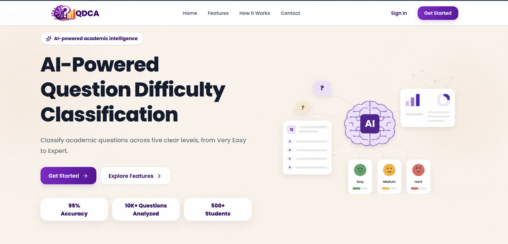

# QDCA — Question Difficulty Classification Agent



**QDCA** helps students and educators classify academic questions by cognitive difficulty, review AI-generated explanations, analyze question sets, and track learning activity.

[Open the live frontend](https://question-difficulty-classification.vercel.app)

## What it does

QDCA evaluates academic questions across five levels:

| Level | Typical question demand |
| --- | --- |
| Very Easy | Direct recall or one obvious step |
| Easy | Simple explanation or direct application |
| Medium | Several routine steps or a connection between concepts |
| Hard | Non-routine analysis or reasoning across multiple constraints |
| Expert | Original design, evaluation, proof, or research-level reasoning |

The platform includes:

- AI-assisted classification with confidence and reasoning details.
- Question actions such as generating answers, explanations, or adjusted versions of a question.
- Subject and topic detection to help organize questions.
- PDF question analysis and upload processing.
- A chatbot that can use question history and retrieved reference material to tailor responses.
- RAG (retrieval-augmented generation) backed by document chunks and vector similarity search.
- Dashboards, activity history, reports, notifications, and study progress views.
- Account authentication and administrator tools for users, questions, uploads, settings, and AI monitoring.

Model availability depends on backend configuration. The backend supports integrations for Groq, OpenRouter, and Ollama. Ollama is also used by the current RAG embedding flow.

## Application layout

The project is split across three existing branches. The branch names below match GitHub; `frontent` is the spelling of the existing frontend branch.

| Branch | Contents |
| --- | --- |
| [`frontent`](https://github.com/Abhish0030/QDCA/tree/frontent) | React/Vite web application in `frontend/` |
| [`Backend`](https://github.com/Abhish0030/QDCA/tree/Backend) | Express/TypeScript API, Prisma schema, and migrations in `backend/` |
| [`LLM`](https://github.com/Abhish0030/QDCA/tree/LLM) | AI, chatbot, subject-detection, and RAG code from both application layers |

The AI features are implemented inside the frontend and backend folders rather than in a standalone LLM service. The LLM branch contains the AI-focused files; use the Frontend and Backend branches for the complete app layers and their supporting code.

### Main technologies

- **Frontend:** React, Vite, React Router, Tailwind CSS, Better Auth client.
- **Backend:** Node.js, Express 5, TypeScript, Zod, Better Auth.
- **Data:** PostgreSQL, Prisma ORM, and the `pgvector` extension for embeddings.
- **AI:** Groq, OpenRouter, and Ollama integrations; Ollama embeddings for the RAG pipeline.
- **Quality:** ESLint on the frontend and Biome on the backend.

## Repository structure

```text
QDCA/
├── frontend/
│   ├── src/
│   │   ├── api/                 # API clients and response helpers
│   │   ├── components/          # Shared interface components
│   │   ├── features/            # Admin, study roadmap, and subject detection
│   │   ├── pages/               # Landing, dashboard, analysis, and account pages
│   │   └── hooks/               # Shared application hooks
│   ├── .env.example             # Frontend environment template
│   └── package.json
├── backend/
│   ├── src/
│   │   ├── auth/                # Better Auth integration
│   │   ├── config/              # Validated environment configuration
│   │   ├── features/            # API routes, controllers, and services
│   │   ├── middleware/          # Shared Express middleware
│   │   └── database/            # Prisma client setup
│   ├── prisma/                  # Schema and database migrations
│   ├── .env.example             # Backend environment template
│   └── package.json
└── docs/
    └── readme-banner.png
```

## Run locally

You need Node.js and pnpm versions compatible with the `packageManager` entry in each package, plus a PostgreSQL database with `pgvector` available. To run the full application, check out the frontend and backend branches in separate worktrees:

```bash
git clone https://github.com/Abhish0030/QDCA.git
cd QDCA
git fetch origin
git worktree add ../QDCA-backend origin/Backend
git worktree add ../QDCA-frontend origin/frontent
```

### 1. Configure and start the backend

Create a local environment file from the template and set at least the database URL, a long random Better Auth secret, and the public backend URL. Configure at least one model provider to enable AI features. For RAG embeddings, configure an available Ollama server and embedding model.

```bash
cd ../QDCA-backend/backend
cp .env.example .env
pnpm install
pnpm prisma generate
pnpm prisma migrate dev
pnpm dev
```

The API runs at `http://localhost:3000` by default. Interactive API documentation is available at `http://localhost:3000/api/docs`; the OpenAPI JSON is at `http://localhost:3000/api/openapi.json`.

### 2. Configure and start the frontend

In a second terminal, set the frontend API origin to the backend address. The checked-in template defaults to the local backend and frontend URLs.

```bash
cd ../QDCA-frontend/frontend
cp .env.example .env
pnpm install
pnpm dev
```

Open `http://localhost:5173`. In production, configure the same frontend variables in Vercel and set the backend's `FRONTEND_URL` to the deployed frontend origin so credentialed requests and authentication redirects use the right origins.

### Environment variables

The `.env.example` files list the supported settings. Common values include:

| Variable | Used by | Purpose |
| --- | --- | --- |
| `DATABASE_URL` | Backend | PostgreSQL connection string |
| `BETTER_AUTH_SECRET` | Backend | Secret used to sign/authenticate sessions; set a strong private value |
| `BETTER_AUTH_URL` | Backend | Public origin where the backend authentication endpoints are served |
| `FRONTEND_URL` | Backend | Allowed frontend origin for CORS and authentication |
| `GROQ_API_KEY` | Backend | Optional Groq model access |
| `OPENROUTER_API_KEY` | Backend | Optional OpenRouter model access |
| `OLLAMA_BASE_URL` | Backend | Ollama server origin for local model and embedding requests |
| `OLLAMA_EMBEDDING_MODEL` | Backend | Ollama embedding model used by RAG |
| `VITE_BACKEND_URL` | Frontend | Backend origin used by the frontend and local Vite proxy |
| `VITE_APP_URL` | Frontend | Frontend origin used for auth redirects |

Keep real credentials in local environment files or deployment secrets. Do not commit `.env` files or put private API keys in frontend variables; Vite exposes `VITE_` values to browser code.

## Useful commands

Run these from the corresponding package directory:

**Frontend**

```bash
pnpm dev       # Start the Vite development server
pnpm build     # Build the production frontend
pnpm preview   # Preview the production build locally
pnpm lint      # Run ESLint
pnpm test      # Run frontend API unit tests
```

**Backend**

```bash
pnpm dev                 # Start the API with file watching
pnpm build               # Generate Prisma Client and compile TypeScript
pnpm start               # Start the compiled API
pnpm test                # Run backend unit tests
pnpm check               # Run Biome checks
pnpm prisma:generate     # Generate Prisma Client
pnpm prisma:migrate      # Run local Prisma migrations
pnpm prisma:studio       # Open Prisma Studio
```

## Authentication and request flow

The frontend calls the backend API and Better Auth endpoints. During local development, Vite proxies `/api` to `VITE_BACKEND_URL`; the frontend can also use the configured backend origin directly. Cross-origin production auth relies on credentialed requests, matching CORS origins, and secure cookie settings on HTTPS. Set the deployed frontend and backend origins consistently in their environment variables.

The backend exposes health endpoints at `/` and `/health`, and API routes under `/api`. The Swagger UI and Scalar reference are available at `/api/docs` and `/api/v1/docs` respectively.

## Contributing

1. Choose the branch that matches the area you are changing: `frontent`, `Backend`, or `LLM`.
2. Keep secrets, local environment files, dependency folders, and build output out of commits.
3. Make changes in the relevant package and run its lint, build, or test scripts as appropriate.
4. Keep frontend and backend API contracts aligned when changing endpoints, request payloads, authentication, or response shapes.

For local full-stack work, use separate frontend and backend worktrees as shown above. The `main` branch is the repository default branch.

## License

See [LICENSE](LICENSE).
